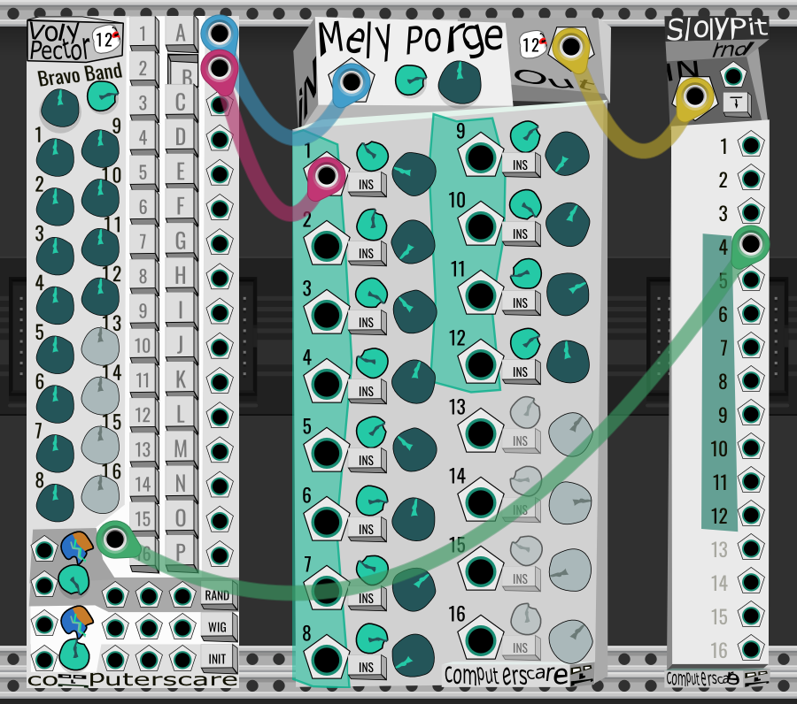

# Advanced Polyphonic Utilities

## Voly Pector

16 polyphonic CV outputs. Edit values by output or by channel. Scale, offset, randomize, and wiggle. [Manual](volypector.md).

## Mely Porge

16-channel polyphonic processor with individual insert inputs, scaling, offsets, crossfades, and VCAs. [Manual](mely-porge.md).

## Sloly Pit

Split a polyphonic input into 16 configurable mono or polyphonic outputs. [Manual](sloly-pit.md).

## Daddy's Home

16-input, 16-output polyphonic router. [Manual](daddys-home.md).
